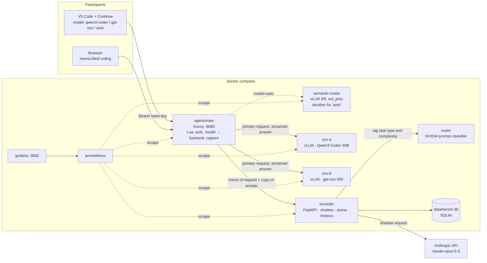

# reyab: open-source vs Opus coding hackathon stack

Participants code in VS Code against two open-source models served locally by
vLLM. Every chat turn is also sent, invisibly, to Claude Opus, so the event
produces a side-by-side dataset: what the OSS model answered, what Opus would
have answered, judged by an LLM, by blind human votes, and by hidden tests.

Everything runs with one `docker compose up` on a single GPU host (built and
tested on an NVIDIA GB10 / DGX Spark, aarch64).

## Architecture



### One chat turn, step by step

1. **Auth and model choice.** VS Code sends an OpenAI-style request with a team
   key. The Lua filter in Envoy checks the key, strips it, reads `"model"` and
   picks the backend: `qwen3-coder` → oss-a, `gpt-oss` → oss-b. For the hidden
   model `auto`, the semantic router classifies the prompt and chooses.
2. **Primary answer.** Envoy forwards the request to the chosen vLLM and streams
   the answer back to VS Code untouched. The participant only ever sees the OSS
   model.
3. **Shadow.** Envoy mirrors the same request to the recorder, which converts it
   to the Anthropic Messages API and sends it to Opus in the background. Opus's
   answer is stored, never shown.
4. **Capture.** As the primary answer streams past, the Lua filter copies the
   chunks and posts the assembled answer to the recorder.
5. **Tagging.** The recorder asks the NVIDIA classifier for task type and
   complexity, so results can be sliced by kind of prompt.
6. **Storage.** One row per turn in `data/bench.db`, keyed by Envoy's
   `x-request-id`: request, OSS answer, Opus answer, tags, route, latency.

### What participants can and cannot see

* `GET /v1/models` lists **only the two OSS models**. Opus has no route on the
  public listener.
* `auto` is accepted when `ENABLE_AUTO=1` but never listed.
* Autocomplete (`/v1/completions`) goes to the OSS models and is not shadowed.
* Their prompts *are* sent to Anthropic. Tell them (see
  [docs/BENCHMARKING.md](docs/BENCHMARKING.md)).

## Components

| Service | Image / code | Role |
|---|---|---|
| `agentrouter` | `envoyproxy/envoy:v1.35-latest`, `envoy/` | Gateway. Public listener `:8080`, organizer listener `:8081`, admin `:9901`. Auth, routing, mirroring, answer capture. |
| `oss-a`, `oss-b` | `nvcr.io/nvidia/vllm:26.11-py3` | The two OSS models, OpenAI-compatible, with tool calling. |
| `semantic-router` | `ghcr.io/vllm-project/semantic-router/vllm-sr:v0.4.0`, `services/semantic-router/` | Envoy ext_proc filter that picks oss-a or oss-b for `auto` from prompt signals. CPU. |
| `router` | `services/router/` | NVIDIA `prompt-task-and-complexity-classifier` (CPU). Tags every turn; `/route` is the `AUTO_ROUTER=nvidia` fallback. |
| `recorder` | `services/recorder/` | Mirror target, OpenAI→Anthropic conversion, Opus shadow, SQLite, blind-vote page, Prometheus metrics. |
| `prometheus`, `grafana` | `prom/prometheus:v3.5.0`, `grafana/grafana:12.1.1`, `observability/` | Optional monitoring (`--profile observability`). |

## Ports

| Port | Bound to | Who uses it |
|---|---|---|
| 8080 | all interfaces | VS Code (`/v1/*`) and the voting page (`/arena`) |
| 8081 | 127.0.0.1 | Organizers: all three models (incl. Opus) behind one OpenAI API, no recording |
| 9901 | 127.0.0.1 | Envoy admin and metrics |
| 3000 | 127.0.0.1 | Grafana |
| 9090 | 127.0.0.1 | Prometheus |

## Quick start

```bash
cp .env.example .env                          # set ANTHROPIC_API_KEY, pick models
cp envoy/teams.lua.example envoy/teams.lua    # one key per team (omit = open gateway, team "anon")
docker compose up -d --build                  # add --profile observability for Prometheus + Grafana
docker compose logs -f oss-a oss-b            # first start downloads the weights
```

Smoke test:

```bash
KEY=hk-REPLACE-ME-team-01
curl -s localhost:8080/v1/models -H "Authorization: Bearer $KEY"     # two models only
curl -s localhost:8080/v1/chat/completions \
  -H "Authorization: Bearer $KEY" -H "content-type: application/json" \
  -d '{"model":"qwen3-coder","messages":[{"role":"user","content":"Write a Python LRU cache."}]}'
sleep 30; docker compose exec recorder python -c \
  "import urllib.request;print(urllib.request.urlopen('http://localhost:8000/stats').read().decode())"
```

**VS Code:** install Continue, copy `clients/continue-config.yaml` to
`~/.continue/config.yaml`, set the gateway host and the team key. For Cline,
see [Using Cline](#using-cline).

### Using Cline

Cline works through its **OpenAI Compatible** provider; the gateway takes the
team key as a normal Bearer key. First check the gateway is reachable from the
participant's machine:

```bash
curl -s http://<gateway>:8080/v1/models -H "Authorization: Bearer <team key>"
```

If it isn't (different network), or to keep the key off the wire in plain
HTTP, tunnel over SSH and use `localhost` as the host:

```bash
ssh -N -L 8080:localhost:8080 <user>@<gateway>
```

Then enter these values in Cline's settings (gear icon); the same values,
commented, are in `clients/cline-settings.yaml`:

| Field | Value |
|---|---|
| API Provider | OpenAI Compatible |
| Base URL | `http://<gateway>:8080/v1` |
| API Key | the team key |
| Model ID | `qwen3-coder`, `gpt-oss` or `auto` |
| Context Window Size | `65536` (vLLM `--max-model-len`) |
| Max Output Tokens | about `8192` |
| Supports Images | off |

Field names vary slightly between Cline versions. Cline has no autocomplete,
so only chat requests reach the gateway.

Things to know:

* **Shadow cost.** Every step of a Cline task is its own request carrying the
  whole conversation, and each is shadowed to Opus: one task can be 10–30
  turns. Watch the shadow token panels in Grafana or lower `SHADOW_RATE`.
* **Agent vs chat.** Some Cline versions describe tools inside the prompt
  rather than in the API's `tools` field. Those turns are recorded as `chat`,
  and `auto` routes them on code keywords or difficulty instead of
  `agent_mode`. Check `has_tools` and `route_reason` in `bench.db` after one
  task.
* **Model fit.** Cline's tool-call format needs a model that follows long
  instructions closely; `qwen3-coder` copes better than `gpt-oss-20b`.
* **Comparisons.** As with Continue, only first turns compare like for like
  with Opus; use `--first-turns`.

**Before the event:** replace the placeholder keys in `envoy/teams.lua`, then
`docker compose restart agentrouter`.

## Configuration (`.env`)

| Variable | Default | Meaning |
|---|---|---|
| `OSS_A_NAME`, `OSS_A_HF_ID` | `qwen3-coder`, `Qwen/Qwen3-Coder-30B-A3B-Instruct-FP8` | Name VS Code sees, Hugging Face model |
| `OSS_B_NAME`, `OSS_B_HF_ID` | `gpt-oss`, `openai/gpt-oss-20b` | Same for model B |
| `OSS_*_GPU_UTIL` | 0.40 / 0.30 | vLLM memory share. On GB10 keep A + B ≤ ~0.85 |
| `OSS_*_MAX_LEN` | 65536 | Context length |
| `OSS_*_EXTRA_ARGS` | tool-call parsers | Without the right `--tool-call-parser`, agent mode breaks |
| `ANTHROPIC_API_KEY` | (empty) | Required for the shadow and the judge |
| `SHADOW_MODEL`, `SHADOW_EFFORT` | `claude-opus-5-5`, `high` | Shadow model and effort |
| `SHADOW_RATE` | 1.0 | Fraction of chat turns shadowed (cost control) |
| `SHADOW_MAX_CONCURRENCY` | 8 | Parallel Opus calls |
| `ARENA_SCOPE` | `team` | `team`: voters see only their team's prompts; `all`: everyone's |
| `ENABLE_AUTO` | 0 | 1 = accept the hidden model `auto` |
| `AUTO_ROUTER` | `vsr` | `vsr` = vLLM Semantic Router; `nvidia` = classifier threshold |
| `ROUTER_COMPLEXITY_THRESHOLD` | 0.22 | Only for `AUTO_ROUTER=nvidia` |
| `GATEWAY_PORT`, `EVAL_PORT` | 8080, 8081 | Listener ports |
| `GRAFANA_PORT`, `PROMETHEUS_PORT`, `GRAFANA_ADMIN_PASSWORD` | 3000, 9090, `admin` | Monitoring |

## The hidden `auto` model

With `ENABLE_AUTO=1`, clients may send `model: "auto"`. Envoy enables the
semantic router's ext_proc filter on that route only. The policy lives in
`services/semantic-router/config.yaml.tmpl`:

| Decision | Signal | Model |
|---|---|---|
| `agent_mode` | request carries tool definitions | qwen3-coder |
| `hard_reasoning` | complexity `hard` (similarity to example hard vs easy prompts) | gpt-oss, reasoning on |
| `code` | code keywords | qwen3-coder |
| (default) | nothing matched | gpt-oss |

Responses carry `x-vsr-selected-model` and `x-vsr-selected-decision`; the
recorder stores `route_reason = vsr:<decision>`. If the router is down, `auto`
is served by model A and recorded as `vsr-fallback`.

Calibrate on real prompts. Preview a decision without generating:

```bash
docker exec reyab-semantic-router curl -s localhost:8080/api/v1/routing/preview \
  -H 'content-type: application/json' \
  -d '{"model":"auto","messages":[{"role":"user","content":"rename x to count"}]}'
```

After editing the policy: `docker compose restart semantic-router`.

## Measuring OSS vs Opus

Three signals, described in **[docs/BENCHMARKING.md](docs/BENCHMARKING.md)**:

1. **Shadow + LLM judge** on live traffic: blind, position-swapped, with a
   cross-family judge to check self-preference. Headline number: OSS
   win-or-tie rate with a 95% interval, on first turns only.
2. **Task-based eval with hidden tests**: run the same agent harness against
   `http://localhost:8081/v1` with each of the three models.
3. **Blind human votes**: `http://<gateway>:8080/arena`. Participants paste
   their team key and compare two anonymous answers (keys 1 left, 2 right,
   3 same, 4 both wrong, S skip). Which side is which model is kept on the
   server; answers that name their maker are never shown.

After (or during) the event:

```bash
pip install -r bench/requirements.txt
python bench/judge.py --db data/bench.db --limit 300                  # Opus judge
python bench/judge.py --db data/bench.db --judge-openai-url http://localhost:8081/v1 \
       --judge-model qwen3-coder                                      # cross-family judge
python bench/report.py --db data/bench.db --first-turns --csv results.csv
```

## Monitoring

```bash
docker compose --profile observability up -d
```

Grafana at `http://localhost:3000` opens on the **reyab hackathon** dashboard
(anonymous read-only; admin password `GRAFANA_ADMIN_PASSWORD`). From a laptop:
`ssh -L 3000:127.0.0.1:3000 <gateway-host>`.

| Row | Source | Shows |
|---|---|---|
| Overview, Traffic | Envoy, recorder | requests per backend, turns per team / model / mode, 5xx, response time |
| Models | vLLM `/metrics` | time to first token, decode speed, queue, KV-cache use, prefix-cache hits |
| Semantic router | vSR `:9190/metrics` | `auto` decisions and decision latency |
| Opus shadow | recorder `/metrics` | answers, errors, fallbacks, latency, tokens |
| Blind votes | recorder `/metrics` | votes by winner |

During the event, watch KV-cache use and waiting requests: a model that stays
near 100% or keeps a queue needs a larger `OSS_*_GPU_UTIL`. To change the
dashboard, edit `observability/build_dashboard.py` and run it.

Logs: `docker logs reyab-agentrouter` prints one JSON line per request (team,
model, backend, route, status, duration, time to first byte).

## Repository layout

| Path | What |
|---|---|
| `docker-compose.yml` | All services; monitoring under the `observability` profile |
| `.env.example` | Every setting, documented |
| `envoy/envoy.yaml` | Listeners, routes, mirror policy, ext_proc filter, clusters |
| `envoy/public.lua`, `envoy/common.lua` | Auth, model → backend, `auto` handling, answer capture |
| `envoy/eval.lua` | Organizer listener exposing all three models |
| `envoy/render.sh` | Substitutes model names into the templates, starts Envoy |
| `envoy/teams.lua.example` | Team keys |
| `services/semantic-router/config.yaml.tmpl` | `auto` routing policy |
| `services/router/` | NVIDIA prompt classifier service |
| `services/recorder/` | Shadow, storage (`db.py`), format conversion (`convert.py`), arena (`arena.py`, `static/arena.html`), metrics (`metrics.py`) |
| `observability/` | Prometheus scrape config, Grafana provisioning, dashboard generator |
| `bench/judge.py`, `bench/report.py` | Offline judge and report |
| `clients/continue-config.yaml` | VS Code (Continue) configuration |
| `clients/cline-settings.yaml` | Values to enter in Cline's settings panel |
| `docs/sizing/infra_sizing.py` | Infrastructure sizing for three open models (64k and 128k context) |
| `docs/slides/` | Architecture, sizing and bill-of-materials slides (deck source) |
| `docs/BENCHMARKING.md` | Evaluation design and experimental hygiene |

## Operations

| Task | Command |
|---|---|
| Status | `docker compose ps` |
| Reload team keys | `docker compose restart agentrouter` |
| Change the `auto` policy | edit the template, `docker compose restart semantic-router` |
| Add the API key later | edit `.env`, `docker compose up -d recorder` |
| Back up results | copy `data/bench.db` (SQLite, WAL mode: stop the recorder or use `sqlite3 .backup`) |
| Stop everything | `docker compose --profile observability down` (volumes and `data/` are kept) |

## Security notes

* Team keys are checked at the gateway and never forwarded upstream.
* Client-sent internal headers (`x-bench-*`, `x-selected-model`, `x-vsr-*`
  controls) are stripped before routing.
* The organizer listener, Envoy admin, Grafana and Prometheus bind to
  127.0.0.1 only.
* The recorder's `/metrics` and `/stats` are reachable only inside the compose
  network.
